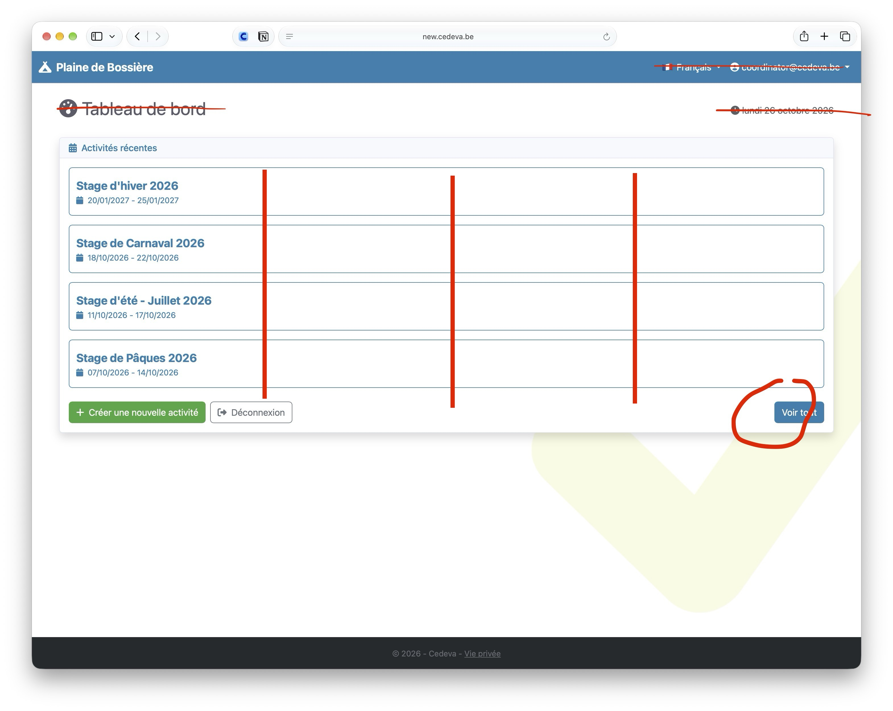
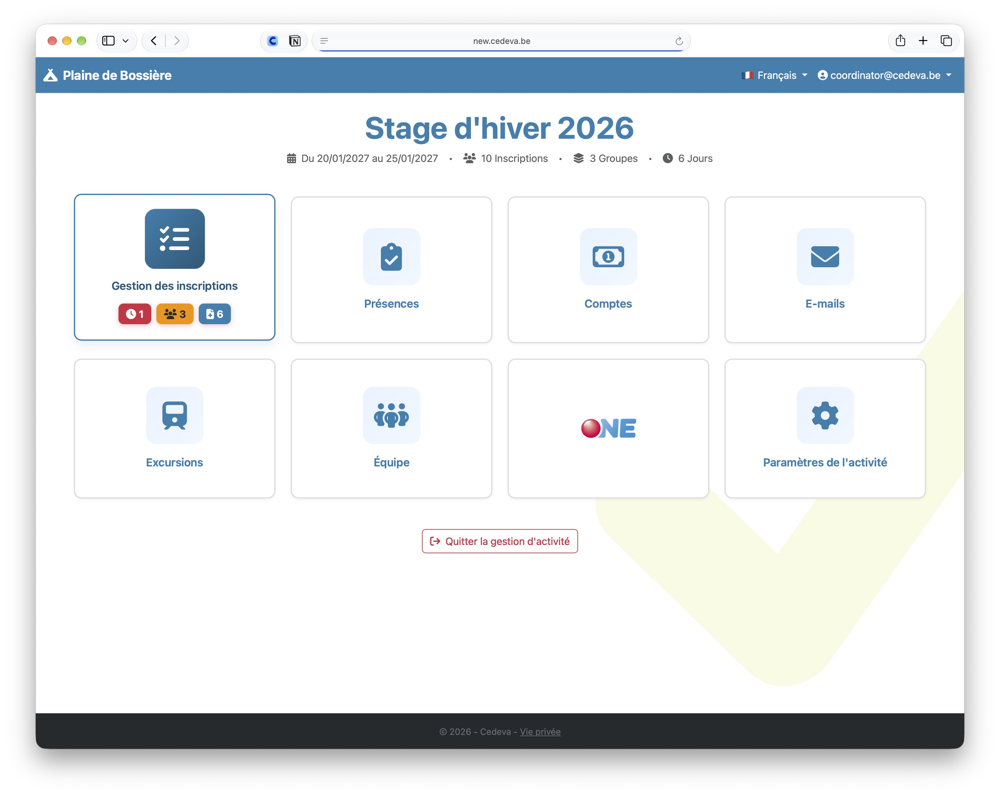
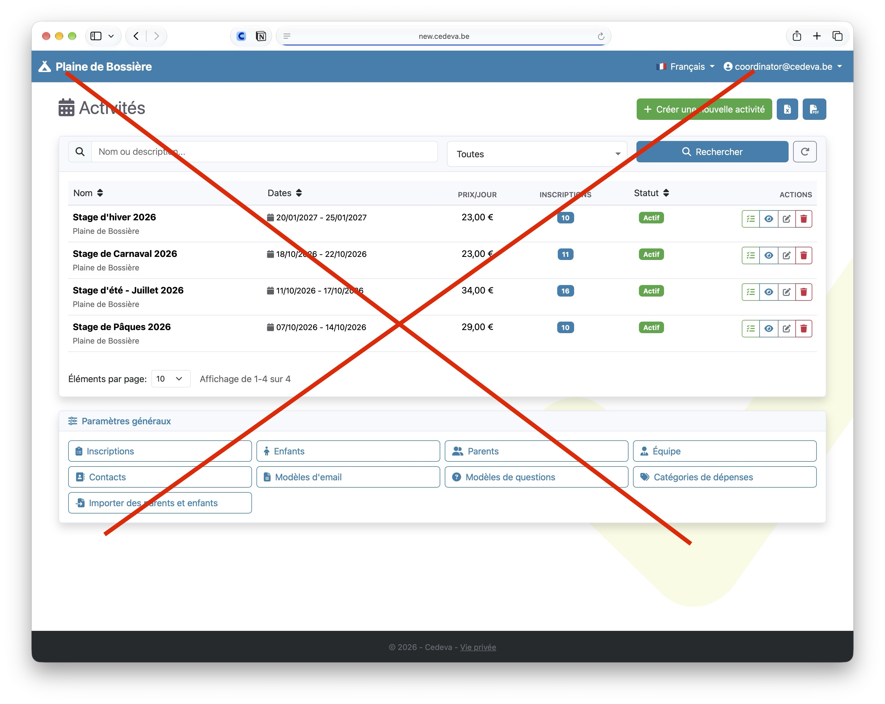
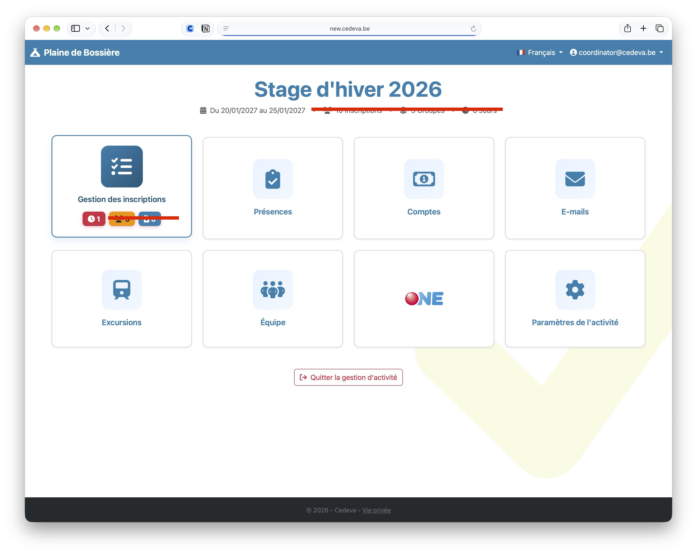

# Accueil

Après la connexion, tu peux simplifier au max et masquer tout ce qui n’est pas utile.

On peut même imaginer une mise en page en rectangle comme quand on rentre dans une activité avec ces 2 infos:

- Nom du stage en grand
- Dates en petit

Quand on clique sur le bloc, on rentre dans le stage.

⬇️ idée de présentation

## Accueil

Le bouton “Voir tout” peut être supprimé.

La page après va embrouiller tout le monde.

## Page Activité précise

On simplifie encore…

En haut, tu peux supprimer le nombre d’inscrits, le nombre de groupes et le nombre de jours.

Dans la première case, tu peux laisser uniquement les inscriptions en attente.